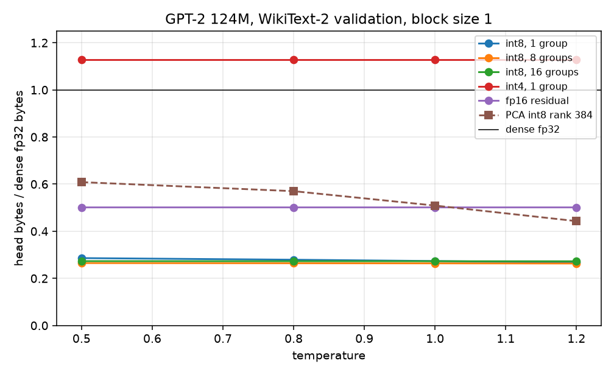
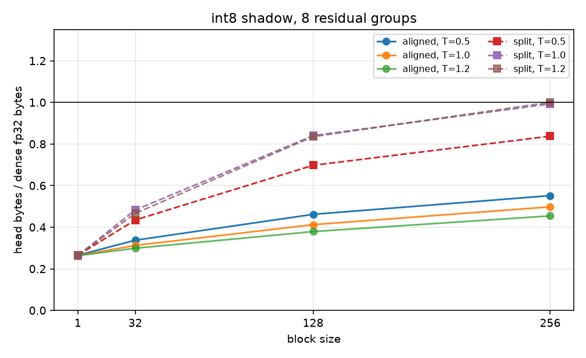
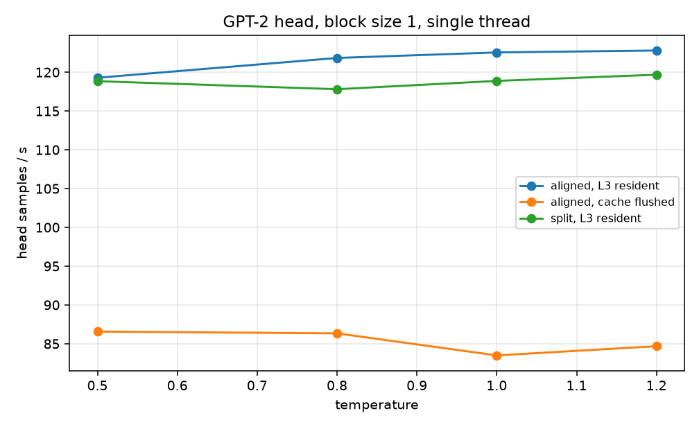

# exact-partial-head-sampling

Exact temperature and top-k sampling that reads only part of the LM output head, using certified block bounds and conditioned Gumbel-max.

## Problem

At batch size 1 every decode step reads the output head \(W \in \mathbb{R}^{V \times d}\). For GPT-2 small (`openai-community/gpt2`, fp32, tied token embedding, no head bias) \(V = 50257\), \(d = 768\), so the matrix is \(50257 \times 768 \times 4 = 154{,}389{,}504\) bytes. Logits are \(\mathrm{ln\_f}(h)\, W^\top\). On the 256 hidden states used below, the maximum absolute difference against Hugging Face `GPT2Model` last-hidden-state logits is \(3.224 \times 10^{-5}\).

From the public GPT-2 small layout in that checkpoint (`n_layer = 12`, `n_embd = 768`, `n_positions = 1024`, `n_inner = 4 \cdot 768`, Conv1D and LayerNorm biases): token embedding \(38{,}597{,}376\), position embedding \(786{,}432\), final LayerNorm \(1{,}536\), twelve blocks of \(7{,}087{,}872\). Total \(124{,}439{,}808\) parameters. The head read is \(38{,}597{,}376 / 124{,}439{,}808 = 0.31017\) of that count, and it is touched again for every new token. The metric in this repository is head bytes read per token. Hidden-state bytes, the one-time shadow build, and the rest of the network are not counted.

Dense temperature sampling still forms, or streams, every logit. FlashSampling fuses the Gumbel-max into that matmul and still reads every row. The certified greedy decoder at <http://knlp.io/lm_head_decode.html> skips rows for argmax and states that sampling needs separate support. CSV-Decode certifies an exact top-k set, then uses an approximate softmax. Top-p is not implemented here.

## Method

Gumbel-max. For \(G_i\) i.i.d. standard Gumbel and \(T > 0\),

\[
i^\star = \arg\max_i \left(\frac{z_i}{T} + G_i\right), \qquad z_i = W_i \cdot h,
\]

has the same law as \(\mathrm{Categorical}(\mathrm{softmax}(z/T))\). Tie break, used everywhere below: larger score, then smaller index. The same rule on logits defines the top-k set.

Shadow. Each row is symmetric int8. The scale is \(s_i = \max(|W_i|) / 127\), or \(10^{-12}\) if the row is zero. Codes are \(q_{ij} = \mathrm{clamp}(\mathrm{round}(W_{ij}/s_i), -127, 127)\) with half-away-from-zero rounding. The residual is \(e_i = W_i - s_i q_i\), formed from the stored scale and codes. The hidden axis is split into \(G\) contiguous groups of width \(d/G\) (\(d\) must be divisible by \(G\)). With \(\sigma \ge 0\) (default \(10^{-3}\))

\[
U_i = s_i \langle q_i, h \rangle + \sum_{g=1}^{G} \|e_i^{(g)}\|_2 \, \|h^{(g)}\|_2 + \sigma.
\]

Group norms of \(e\) and of \(h\) are rounded up to the next fp32 value (`nextafter` when the cast underestimates). Dots accumulate in fp64 and are stored as fp32. \(\sigma\) covers the remaining fp32 rounding in the int8 dot. The shipped kernel uses \(G = 8\).

Partition. Vocabulary indices are contiguous blocks of width \(B\) (the last block may be short). Two ceilings:

- Aligned: \(C_b = \max_{i \in b}(U_i/T + G_i)\). Needs one Gumbel per token. Same shadow traffic as the split ceiling, tighter stopping rule. This is the byte-optimal path. \(B = 1\) makes the two ceilings identical in exact arithmetic.
- Split: \(C_b = (\max_{i \in b} U_i)/T + M_b\), where \(M_b = \max_{i \in b} G_i\). Only the block maximum is required to decide whether to open \(b\). The online sampler draws \(M_b = \log n_b + G'_b\) directly.

Blocks are opened in decreasing \(C_b\) (equal keys: smaller block index first). A block is opened while no incumbent exists or while \(C_b \ge s^\star\), where \(s^\star\) is the best realized score \(z_i/T + G_i\) among opened rows. The scan stops at the first block with \(C_b < s^\star\).

Inside an opened split block the noises are drawn conditional on \(M_b\): one uniform index receives the stored fp32 value of \(M_b\), and the other indices receive a Gumbel truncated strictly below that fp32 value. A truncated draw that rounds to a float \(\ge M_b\) is stepped down with `nextafter`. The aligned path and the top-k path draw the full Gumbel vector first and then call the same opening rule (`sample_with_gumbels`). `top_k > 0` ignores `CertMode`.

Top-k. Certify the exact top-k logit set, then run Gumbel-max on that set only. Blocks are ordered by \(\max_{i \in b} U_i\). Rows are read until \(k\) logits are in hand and the next block satisfies \(\max_{i \in b} U_i < z_{(k)}\), where \(z_{(k)}\) is the worst logit in the current set under the logit tie break (smaller logit, then larger index, is worse). Equality opens the block, so a tied logit with a smaller index can enter. Because \(T > 0\) does not change the ordering of logits, the opened set does not depend on temperature. `top_k = 0` means the full vocabulary. `top_k = V` reads every row.

Top-p is out of scope. The nucleus is a softmax CDF constraint. A logit upper bound does not identify that set without enough of the mass to pin the CDF, and an \(\varepsilon\)-TV softmax (the CSV-Decode softmax path) is not the exact categorical.

## Proof

**Gumbel-max.** Let \(E_i\) be i.i.d. unit exponential and \(G_i = -\log E_i\). The CDF of \(G_i\) is \(\exp(-e^{-x})\). For a finite set \(S\) and \(T > 0\),

\[
P(i^\star = j) = P\left(E_j e^{-z_j/T} < E_i e^{-z_i/T} \text{ for all } i \in S\setminus\{j\}\right).
\]

The products \(E_i e^{-z_i/T}\) are independent exponential random variables with rates \(e^{z_i/T}\), and the minimum is at \(j\) with probability proportional to that rate. Therefore \(i^\star\) is \(\mathrm{softmax}(z_S / T)\) on \(S\). Full-vocabulary temperature sampling is \(S = \{1,\ldots,V\}\). Top-k sampling in the sense used here is the same law restricted to the exact top-k logit set.

**Block maximum.** For \(n\) i.i.d. standard Gumbels,

\[
P(\max_{i\le n} G_i \le x) = \exp(-n e^{-x}) = \exp(-e^{-(x - \log n)}),
\]

so \(M = \log n + G'\) with \(G'\) standard Gumbel. The argmax index is uniform on the \(n\) positions and independent of \(M\): the joint density of i.i.d. Gumbels is invariant under permutation, and the maximizer is a function of the order.

**Truncation.** \(G < m\) iff \(E > e^{-m}\). A unit exponential conditioned on exceeding \(a > 0\) has the law \(a + E'\). Hence

\[
G \mid G < m \;\stackrel{d}{=}\; -\log(e^{-m} + E'), \qquad E' \sim \mathrm{Exp}(1).
\]

The implementation evaluates that logarithm as a log-sum-exp. Given \(M = m\) and a uniform argmax \(J\), the remaining coordinates are i.i.d. copies of this truncated law and are independent of \(J\). Drawing \(M\) first, assigning it to a uniform index, and filling the rest with truncated draws therefore has the joint law of \(n\) i.i.d. Gumbels. The read set of the online split sampler is a function of \((U, M_b)\) only. Conditional on the noises, the returned index is the Gumbel-max argmax, because every unopened coordinate is certified below the incumbent.

**Logit bound.** By construction \(z_i = s_i \langle q_i, h \rangle + \langle e_i, h \rangle\). Cauchy-Schwarz on each contiguous group gives \(\langle e_i^{(g)}, h^{(g)} \rangle \le \|e_i^{(g)}\|_2 \|h^{(g)}\|_2\). Summing groups,

\[
\langle e_i, h \rangle \le \sum_g \|e_i^{(g)}\|_2 \|h^{(g)}\|_2 \le \|e_i\|_2 \|h\|_2,
\]

where the second inequality is Cauchy-Schwarz on the vectors of group norms. More groups can only tighten the residual term. Rounding those norms upward preserves the inequality in fp32. Adding \(\sigma \ge 0\) preserves it. Thus \(U_i \ge z_i\) whenever the fp32 int8 dot does not overshoot \(s_i \langle q_i, h \rangle\) by more than \(\sigma\). On the GPT-2 dump, with \(G = 8\) and \(\sigma = 10^{-3}\), \(\min(U_i - z_i) = 0.664402\) over all \(256 \times 50257\) pairs (AVX2 kernel). The certificate is against this kernel's fp32 matmul, not against a higher-precision logit.

**Aligned ceiling.** \(U_i \ge z_i\) implies

\[
C_b = \max_{i \in b}\left(\frac{U_i}{T} + G_i\right) \ge \max_{i \in b}\left(\frac{z_i}{T} + G_i\right).
\]

**Split ceiling.** \(G_i \le M_b\) and \(z_i \le \max_{j \in b} U_j\) imply

\[
\frac{z_i}{T} + G_i \le \frac{\max_{j \in b} U_j}{T} + M_b = C_b.
\]

**Stopping.** Let \(s^\star\) be the best opened score under the tie break. If a block is not opened, every block still closed has ceiling \(\le\) the first rejected ceiling, and that ceiling is \(< s^\star\). Every unopened token then has score \(< s^\star\), so it cannot win. Opening when \(C_b \ge s^\star\) keeps a token whose score equals \(s^\star\) and whose index is smaller. Under a continuous Gumbel law \(P(C_b = s^\star) = 0\); the comparison is there so fp32 ties follow the same rule as the dense scan. The dense sampler reads every row, applies the same tie break, and, for top-k, keeps the same logit set. Shared Gumbel vectors therefore produce the same index whenever both sides use those vectors (aligned path, split path with pre-drawn noises, and top-k). The online split path generates noises internally; its law equals the dense law in real arithmetic, and in fp32 up to the `nextafter` clamp described above.

**Top-k set.** Suppose \(k\) logits have been read and every unopened token has \(U_i < z_{(k)}\). Then its true logit is \(< z_{(k)}\), so it cannot enter the set under the logit tie break. The set is exactly the dense top-k set. Gumbel-max on that set is \(\mathrm{softmax}(z/T)\) restricted to it. Temperature is not consulted while the set is built.

## Complexity

Shadow construction is one pass over \(W\): \(O(Vd)\) time, done once. It is not charged to the per-token byte count.

Per token, both modes read the whole shadow: \(Vd\) int8 codes, \(V\) fp32 scales, \(VG\) fp32 group norms. They then sort \(B_{\mathrm{blk}} = \lceil V / B \rceil\) keys and read \(r\) fp32 rows. Arithmetic is \(O(Vd)\) for the int8 dots, \(O(V)\) to form keys, \(O(B_{\mathrm{blk}} \log B_{\mathrm{blk}})\) to sort, and \(O(rd)\) for the opened fp32 dots. Head bytes are

\[
Vd + 4V + 4VG + 4rd
\]

against dense \(4Vd\). For GPT-2 with \(G = 8\),

| term | bytes |
| --- | ---: |
| int8 codes | 38,597,376 |
| fp32 scales | 201,028 |
| fp32 group norms | 1,608,224 |
| shadow total | 40,406,628 |
| dense fp32 head | 154,389,504 |

The shadow is \(40{,}406{,}628 / 154{,}389{,}504 = 0.26171875\) of the dense head. That is a floor: every token pays it, including tokens whose fp32 row is never read. At \(B = 1\) the sort is over \(V\) keys. That term does not move bytes and it does move latency when the head already sits in L3.

## Memory layout

`Head::w` is row-major fp32, index \(i d + j\). `Shadow::codes` is row-major int8 with the same index. `Shadow::scale` has one fp32 per row. `Shadow::group_norm` is row-major fp32 of shape \([V, G]\), group \(g\) covering hidden coordinates \([g d/G,\ (g+1)d/G)\).

The AVX2 int8 dot loads 16 codes, sign-extends the low 8 and the high 8 to int32, converts to fp32, and FMA-accumulates into a double horizontal sum. The scalar dot is the same accumulation without SIMD. Both translation units are built with `-ffp-contract=off`. Only `gemv_avx2.cpp` is built with `-mavx2 -mfma`. The scalar file stays scalar. Runtime selection uses `__builtin_cpu_supports("avx2")`.

Dump `EPHS0001`, little endian: 8-byte magic, `u32` vocab, `u32` hidden, `u32` n_states, then fp32 \(W\) in row-major order, then fp32 hidden states packed \([n_{\mathrm{states}}, d]\). `analysis/export_gpt2_head.py` writes this from the cached fp32 embedding and the cached WikiText-2 states. Weights are not stored in git.

## Build

C++20, CMake, Ninja. CI (`.github/workflows/ci.yml`) builds GCC and Clang, Debug with ASan+UBSan and Release without, and rejects `clang-format` diffs.

```
cmake -S . -B build -G Ninja -DCMAKE_BUILD_TYPE=Release
cmake --build build
ctest --test-dir build --output-on-failure
```

Sanitizers: `-DEPHS_SANITIZERS=ON`. Benchmark, single thread, after exporting a dump:

```
taskset -c 0 ./build/ephs_bench \
  --dump analysis/cache/gpt2_head.bin \
  --out analysis/results/bench.json \
  --groups 8 --seed 12345
```

Python (`analysis/`) is only the go/no-go sweep, the dump export, and the plots. Versions used for the JSON in `analysis/results/`: torch 2.14.1+cpu, transformers 5.21.0, numpy 2.5.4, matplotlib 3.11.2, pyarrow 26.0.0, huggingface_hub 2.3.0. WikiText-2-raw-v1 was read from the Salesforce parquet files. `numpy.round` is bankers' rounding; the C++ shadow uses `std::round`. Byte ratios in the Python tables are a separate estimator. The kernel numbers are `bench.json`.

Tests (`ephs_tests`): Gumbel mean and variance at \(n = 20000\); Kolmogorov-Smirnov PIT of truncated Gumbels at \(n = 15000\); chi-square of the block argmax over 5 slots; AVX2 versus scalar dots; \(U_i \ge z_i\) on a random \(d = 768\), \(G = 8\) head; a zero row that must open one row at \(B = 1\); a huge \(\sigma\) that must read every row; token coupling against the dense sampler over both backends, block sizes \(\{1,3,16,48\}\), temperatures \(\{0.5, 1.1\}\), and top-k \(\{0,1,4,7\}\); chi-square and KS at \(n = 20000\), \(V = 12\), \(d = 16\), \(G = 4\) for aligned \(B \in \{1,5\}\), online split \(B \in \{1,7\}\), and top-k 5 and 4. The chi-square check fails the binary if the survival function is \(< 10^{-8}\) or the KS p-value is \(< 10^{-6}\).

## Results

Go on GPT-2. No Qwen2.5-0.5B run. The decision rule used while measuring: a mean byte ratio \(\le 0.67\) across \(T \in \{0.5, 0.8, 1.0, 1.2\}\) is enough to build the kernel; a ratio \(\ge 0.85\) is negligible. Row-wise int8 with 8 groups sits at about \(0.264\). Affine PCA and a Gram-SVD basis of \(W\) do not.

Hidden states: WikiText-2-raw-v1, sequences of length 128, stride 128. PCA was fit on 4,000 train states. Eval is 256 validation states. Python sweeps use 2 independent Gumbel replicates (seed base 0). The C++ bench uses seed 12345 and one draw per state. Python open-counts use a strict inequality against the winner score and then force the winner's block open. The C++ kernel opens while \(C_b \ge s^\star\). On this head the two ratios still match to a few ten-thousandths for int8, \(G = 8\), \(B = 1\).

### Low-rank shadows (Python, not shipped)

Affine PCA of centered train hidden states, rank-384 basis, explained variance fraction \(0.99746662\). Smaller ranks are prefixes. The SVD basis is the leading eigenspace of \(W^\top W\) through the origin. Byte ratio is shadow bytes plus opened fp32 rows, divided by \(154{,}389{,}504\). Block size 1, aligned ceiling.

| config | shadow fraction | slack p50 | \(T=0.5\) | \(T=0.8\) | \(T=1.0\) | \(T=1.2\) |
| --- | ---: | ---: | ---: | ---: | ---: | ---: |
| PCA r32 int8 | 0.01628 | 40.89 | 1.0004 | 0.9929 | 0.9857 | 0.9772 |
| PCA r64 int8 | 0.02734 | 35.04 | 1.0000 | 0.9902 | 0.9874 | 0.9836 |
| PCA r128 int8 | 0.04944 | 28.95 | 1.0121 | 1.0019 | 0.9909 | 0.9796 |
| PCA r192 int8 | 0.07155 | 25.02 | 1.0089 | 0.9935 | 0.9728 | 0.9342 |
| PCA r256 int8 | 0.09366 | 21.64 | 0.9601 | 0.9291 | 0.8892 | 0.8224 |
| PCA r384 int8 | 0.13787 | 15.91 | 0.6084 | 0.5702 | 0.5090 | 0.4431 |
| PCA r384 fp32 | 0.51026 | 14.49 | 0.8535 | 0.8192 | 0.7737 | 0.7213 |
| SVD r32 fp32 | 0.04363 | 688.36 | 1.0436 | 1.0436 | 1.0436 | 1.0436 |
| SVD r384 fp32 | 0.50896 | 357.96 | 1.5090 | 1.5090 | 1.5090 | 1.5090 |

SVD-of-\(W\) fp32 slack p50 runs from 688 at rank 32 to 358 at rank 384. Every SVD config in `gpt2_shadow.json` reads more head bytes than the dense matmul at every temperature in the grid: the residual bound does not eliminate rows, and the shadow is pure overhead. Best low-rank point is PCA rank 384 int8, still \(0.44\) to \(0.61\) of dense, and worse as \(T\) drops. That is the knlp-style certificate (low-rank factor of the hidden state, int8 on the projected rows, Cauchy-Schwarz on the residual). It does not pay for Gumbel-max on this 124M head.

### Row quantizers (Python)

`q768` is one scale per row. `q64` is one scale per 64 contiguous weights. Slack is \(U - z\) before the C++ safety term. Byte ratios are block size 1, aligned, except the two top-k columns (also block size 1).

| config | shadow | slack min | slack p50 | \(T=0.5\) | \(T=0.8\) | \(T=1.0\) | \(T=1.2\) | top-1 | top-50 |
| --- | ---: | ---: | ---: | ---: | ---: | ---: | ---: | ---: | ---: |
| int8 g1 | 0.2526 | 0.998 | 7.939 | 0.2861 | 0.2792 | 0.2736 | 0.2669 | 0.2908 | 0.4994 |
| int8 g8 | 0.2617 | 0.663 | 4.976 | 0.2650 | 0.2643 | 0.2638 | 0.2632 | 0.2655 | 0.3174 |
| int8 g16 | 0.2721 | 0.542 | 3.800 | 0.2732 | 0.2730 | 0.2728 | 0.2727 | 0.2734 | 0.2959 |
| int8 g32 | 0.2930 | 0.406 | 2.858 | 0.2934 | 0.2933 | 0.2933 | 0.2932 | 0.2935 | 0.3040 |
| int8, scale group 64, g1 | 0.2669 | 0.848 | 5.698 | 0.2696 | 0.2690 | 0.2685 | 0.2680 | 0.2701 | 0.3275 |
| int8, scale group 64, g12 | 0.2813 | 0.453 | 2.849 | 0.2815 | 0.2815 | 0.2814 | 0.2814 | 0.2815 | 0.2899 |
| int4 g1 | 0.1276 | 19.78 | 143.6 | 1.1276 | 1.1276 | 1.1276 | 1.1276 |  |  |
| int4 g16 | 0.1471 | 9.624 | 68.83 | 1.1440 | 1.1439 | 1.1424 | 1.1423 |  |  |
| fp16 g1 | 0.5013 | 0.021 | 0.190 | 0.5013 | 0.5013 | 0.5013 | 0.5013 |  |  |
| fp16 g16 | 0.5208 | 0.011 | 0.090 | 0.5209 | 0.5209 | 0.5209 | 0.5209 |  |  |

\(G = 8\) is the minimum of the full-vocab int8 column. \(G = 1\) has a smaller shadow and a looser residual, so it opens more fp32 rows (1,055 mean rows at \(T = 1\), versus 104 for \(G = 8\)). \(G = 16\) and \(G = 32\) tighten slack, and the extra norm bytes exceed the fp32 rows saved. Symmetric int4 uses one scale per row (or per 16 groups of the residual, still one code scale over the full row in the `q768` configs); outlier weights set that scale and the bound does not reject rows. fp16 residuals are tight and already half of the fp32 matrix.

Lower temperature opens slightly more rows, not fewer. Slack of several nats is multiplied by \(1/T\) in the ceiling, which outweighs the larger logit gaps among near-top tokens. Mean rows for int8 \(G = 8\), aligned, \(B = 1\): 165.8 at \(T = 0.5\), 129.6 at \(0.8\), 103.5 at \(1.0\), 74.0 at \(1.2\).

Block size on the same int8 \(G = 8\) shadow (Python):

| \(T\) | mode | \(B=1\) | \(B=32\) | \(B=128\) | \(B=256\) |
| --- | --- | ---: | ---: | ---: | ---: |
| 0.5 | aligned | 0.2650 | 0.3373 | 0.4618 | 0.5517 |
| 1.0 | aligned | 0.2638 | 0.3124 | 0.4120 | 0.4978 |
| 1.0 | split | 0.2638 | 0.4827 | 0.8400 | 0.9928 |
| 1.2 | aligned | 0.2632 | 0.2988 | 0.3788 | 0.4543 |

\(B = 1\) is a legal partition: \(n_b = 1\), the block max is the token's own Gumbel, and the conditional fill is empty. Coarser blocks add fp32 rows that the per-token bound had already rejected. Aligned dominates split once \(B > 1\), because split charges \(\max U\) and \(\max G\) to every token in the block.





Entropy quartiles for int8 \(G = 8\), aligned, \(B = 1\), \(T = 1\), Python (512 draws, 128 per bin): entropy means 1.215, 3.248, 4.566, 6.388 with byte ratios 0.2624, 0.2633, 0.2645, 0.2650. The ratio barely moves. The shadow floor is 0.2617, so the fp32 rows are a few thousandths of the dense head across this entropy range.

### C++ kernel

Hardware, from this VM, single thread pinned with `taskset -c 0`: Intel Xeon, family 6, model 207, stepping 2, 4 cores, 2400 MHz, KVM. L1d 48 KiB \(\times\) 4, L1i 32 KiB \(\times\) 4, L2 2 MiB \(\times\) 4, L3 320 MiB. AVX2, FMA, AVX-512, and `clflushopt` are present. The kernel uses AVX2+FMA only. The fp32 head is 147.2 MiB and fits in L3, so a hot run is cache-resident. Cold runs execute `clflushopt` and `sfence` over the head and the shadow before each token. Hot timings use all 256 states. Cold timings use the first 32. `safety = 0.001`, groups \(= 8\), backend AVX2. Exactness checks on all 256 states, shared Gumbels, returned 0 token mismatches for: \(T \in \{0.5, 1, 1.2\}\), \(k = 0\), \(B = 1\), aligned; \(T = 1\), split, \(B = 1\); \(T = 1\), aligned, \(B = 32\); \(T = 1\), \(k = 1\); \(T \in \{0.5, 1\}\), \(k = 50\).

Hot, full vocabulary, \(B = 1\). Dense numbers are the paired dense run in the same configuration (the dense path does not depend on the partial mode; its latency still moves between runs).

| \(T\) | mode | byte ratio | rows | partial us | partial tok/s | dense us | dense tok/s |
| --- | --- | ---: | ---: | ---: | ---: | ---: | ---: |
| 0.5 | aligned | 0.26493 | 161.50 | 8383 | 119.3 | 6357 | 157.3 |
| 0.5 | split | 0.26507 | 168.48 | 8414 | 118.8 | 6224 | 160.7 |
| 0.8 | aligned | 0.26397 | 113.18 | 8207 | 121.8 | 5937 | 168.4 |
| 0.8 | split | 0.26403 | 116.40 | 8488 | 117.8 | 5949 | 168.1 |
| 1.0 | aligned | 0.26342 | 85.44 | 8160 | 122.6 | 5902 | 169.4 |
| 1.0 | split | 0.26377 | 103.11 | 8412 | 118.9 | 5957 | 167.9 |
| 1.2 | aligned | 0.26298 | 63.41 | 8143 | 122.8 | 5889 | 169.8 |
| 1.2 | split | 0.26315 | 72.04 | 8356 | 119.7 | 5935 | 168.5 |

JSON stores the non-dyadic temperatures as the fp32 values 0.8000000119 and 1.200000048. The table rounds those labels to 0.8 and 1.2. Microseconds are means, rounded to the nearest microsecond; tok/s is \(10^6\) over the unrounded mean.

Hot, \(T = 1\), \(k = 0\), block sweep:

| \(B\) | mode | byte ratio | rows | partial us | partial tok/s | dense tok/s |
| --- | --- | ---: | ---: | ---: | ---: | ---: |
| 32 | aligned | 0.30346 | 2098 | 4819 | 207.5 | 164.1 |
| 32 | split | 0.48394 | 11168 | 6011 | 166.4 | 168.2 |
| 128 | aligned | 0.38972 | 6433 | 5444 | 183.7 | 168.3 |
| 128 | split | 0.81628 | 27871 | 8950 | 111.7 | 156.4 |
| 256 | aligned | 0.46908 | 10421 | 6988 | 143.1 | 162.9 |
| 256 | split | 1.00428 | 37319 | 10691 | 93.5 | 168.0 |

Hot top-k, aligned, \(B = 1\). The opened set does not depend on \(T\); the three temperatures share one byte ratio.

| \(k\) | byte ratio | rows | \(T=1\) partial tok/s | \(T=1\) dense tok/s |
| --- | ---: | ---: | ---: | ---: |
| 1 | 0.26555 | 192.48 | 120.9 | 147.7 |
| 50 | 0.31746 | 2801.15 | 103.3 | 133.8 |

Cold, aligned, \(B = 1\), \(n = 32\), `clflushopt` before every token:

| \(T\) | \(k\) | byte ratio | rows | partial us | partial tok/s | dense us | dense tok/s |
| --- | --- | ---: | ---: | ---: | ---: | ---: | ---: |
| 0.5 | 0 | 0.26461 | 145.06 | 11552 | 86.6 | 14571 | 68.6 |
| 0.8 | 0 | 0.26359 | 94.09 | 11583 | 86.3 | 14858 | 67.3 |
| 1.0 | 0 | 0.26305 | 66.72 | 11977 | 83.5 | 15113 | 66.2 |
| 1.2 | 0 | 0.26274 | 51.25 | 11809 | 84.7 | 14851 | 67.3 |
| 1.0 | 50 | 0.29959 | 1903.1 | 12683 | 78.8 | 16320 | 61.3 |

At \(T = 1\), cold partial tok/s divided by cold dense tok/s is \(83.49 / 66.17 = 1.26\). Bytes are \(0.263\) of dense, which is a \(3.80\times\) cut, and latency does not follow. Effective traffic during the timed call is about \(40.6\,\mathrm{MB} / 12.0\,\mathrm{ms} \approx 3.4\,\mathrm{GB/s}\) for the partial kernel and \(154\,\mathrm{MB} / 15.1\,\mathrm{ms} \approx 10.2\,\mathrm{GB/s}\) for the dense GEMV. The int8 expand is not DRAM-saturated on this VM.

L3-resident, \(B = 1\) partial is slower than dense: about 8.2 ms (123 tok/s) against about 5.9 ms (169 tok/s) at \(T = 1\). The int8 scan, \(V\) Gumbel draws, and a 50,257-key sort cost more than a sequential fp32 GEMV once the matrix is hot. Aligned \(B = 32\) is the fastest hot point measured, 207.5 tok/s at byte ratio 0.303, against a paired dense run at 164.1 tok/s. Sorting 1,571 keys instead of 50,257 is the plausible cause; the benchmark does not separate sort time from dot time.

C++ entropy quartiles, hot aligned \(B = 1\), 256 states sorted by \(\mathrm{softmax}(z/T)\) entropy, 64 states in the last bin and 64 in each of the others:

| \(T\) | bin entropies | bin byte ratios |
| --- | --- | --- |
| 0.5 | 0.107, 0.703, 1.365, 2.483 | 0.2624, 0.2636, 0.2647, 0.2690 |
| 0.8 | 0.580, 1.977, 3.011, 4.695 | 0.2623, 0.2631, 0.2648, 0.2657 |
| 1.0 | 1.215, 3.248, 4.566, 6.388 | 0.2623, 0.2632, 0.2639, 0.2643 |
| 1.2 | 2.222, 4.843, 6.144, 7.665 | 0.2624, 0.2632, 0.2632, 0.2631 |



The latency plot is partial only. Cold split was not timed. Dense tok/s are in the tables.

## Limitations

- The certificate reads the entire int8 shadow on every token. For \(G = 8\) that floor is 26.171875% of the fp32 head. Full-vocab sampling at \(B = 1\) adds well under one percent of dense bytes in fp32 rows, so further tightening of \(U_i\) cannot move the ratio below \(0.26171875\) without shrinking the shadow.
- Byte reduction is not latency reduction on this CPU. Hot \(B = 1\) loses to dense. Cold \(B = 1\) wins by about \(1.26\times\) at \(T = 1\), not by \(3.8\times\).
- \(B = 32\) aligned is faster when the head is hot and reads more bytes (ratio 0.303 at \(T = 1\)). The sort is part of the measured kernel; it is not a separate optimized index.
- Top-p is not implemented.
- \(\sigma = 10^{-3}\) and upward-rounded norms make \(U_i\) a bound for this fp32 matmul. The measured minimum gap on the dump is 0.664. A different accumulation order, or contraction, is outside that check.
- Top-k tie break is higher logit, then lower index. A framework that breaks logit ties differently can return a different set of size \(k\).
- Online split stores \(M_b\) as fp32 and clamps truncated draws that round above it. That is a rounding correction, not part of the real-arithmetic identity.
- Python `np.round` and C++ `std::round` disagree on exact halves. Do not bit-compare the two shadows. Kernel results are the C++ shadow.
- One thread, AVX2, head stage only. No batching, no speculative decode, no full forward pass.
- Eval text is WikiText-2 validation, 256 states, sequence length 128. Cold latency is 32 states. Two Python replicates. This is not a serving trace.
- int4 and the low-rank PCA / SVD shadows lose on this head. Nothing here says they lose on a larger head.
- The greedy page's 0.5B latency loss is a different kernel and a different model. It was not remeasured.

## Prior work

FlashSampling. Tomas Ruiz, Zhen Qin, Yifan Zhang, Xuyang Shen, Yiran Zhong, Mengdi Wang. arXiv:2603.15854. Fuses exact Gumbel-max sampling into the tiled head matmul. The head is still streamed in full. That paper cites Gumbel, *Statistical Theory of Extreme Values and Some Practical Applications*, NBS Applied Mathematics Series 33, 1954, and Maddison, Tarlow, Minka, *A\* Sampling*, NeurIPS 2014, for the Gumbel-max identity. Two versions of the FlashSampling writeup state different end-to-end speedups; no speedup figure is repeated here.

Certified greedy LM-head decode. <http://knlp.io/lm_head_decode.html>. No author is named on that page. The page describes greedy argmax, not sampling, and says sampling needs separate support. It reports a PCA basis of rank about \(0.36 d\) on decode hidden states, an int8 factor \(W_U B\) of about 18% of the bf16 head, a per-row residual, and an upper bound of the form \(\widehat{W}q + \rho\,\delta\) plus a slack term in \(\|q\|\). It reports about \(5\times\) fewer head bytes on Qwen2.5-7B (shadow about 18% plus about 2% exact fetch), a latency loss on the 0.5B model (about 15.8% exact fetch plus an 18% shadow), agreement of 0.998 rather than 1.000 on some optimized runs, and an estimate that the head is about 7% of 7B step traffic. Those figures are the page's, measured on their stack. The same style of low-rank int8 bound, remeasured here on GPT-2 fp32 WikiText-2 states, is the PCA block in the results section: rank 384 int8 still reads 0.44 to 0.61 of the dense fp32 head.

CSV-Decode. Dong Liu, Shu Wang, Yanxuan Yu, Haisheng Wang, Ben Lengerich. arXiv:2511.21702. Code: <https://github.com/FastLM/CSV-Decode>. Exact top-k by opening clusters whose centroid-plus-radius upper bound can still enter the top-k set (Cauchy-Schwarz). The softmax path is an \(\varepsilon\) total-variation certificate, not an exact categorical. Their tables list Qwen2.5 vocab size 151,552. This repository does not remeasure that system. The top-k path here is exact Gumbel-max on the certified logit set; it is not their cluster index and it is not their softmax approximation.
